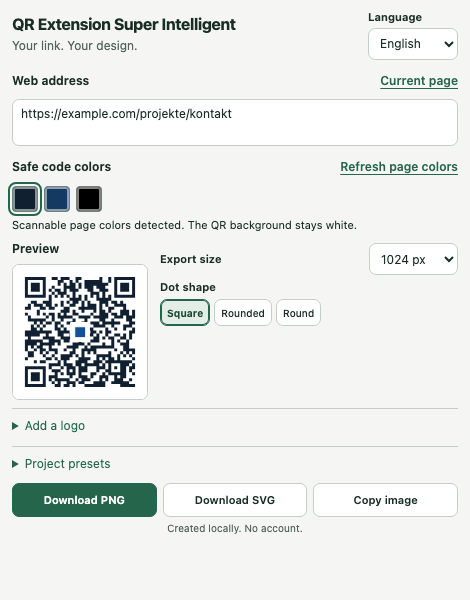

# QR Extension Super Intelligent

[Deutsch](README.md) · [Installation & usage](docs/INSTALLATION.en.md) · [Privacy](docs/PRIVACY.en.md)

Create styled QR codes for websites and individual pages from your browser. Free, no user account, local processing, and MIT licensed.



## Features

- Use the current URL, including query parameters and fragment, or enter your own.
- Suggest up to four common CSS page colors when they reach at least 7:1 contrast against white; black is always available.
- Choose a safe code color, square/rounded/round dots, and export size. The QR background always stays white.
- Optionally detect a visible header logo and capture it locally, or upload PNG, JPEG, or WebP.
- Preview or remove the logo before exporting.
- Save colors, dot style, size, and logo as named local project presets; update or delete presets.
- Export PNG and SVG. Logos use high QR error correction and an independent local decoding check before export.
- Copy the QR code as a PNG image to the clipboard on demand, then paste it into supported apps.
- German and English interface.

Color suggestions reflect page styling rather than an exact count of all image pixels; only colors with at least 7:1 contrast against white are shown. Logo detection cannot work on every website. The product name does not indicate an AI feature: there is no AI service or cloud processing.

## Installation

**Firefox, Chrome, and Edge store releases are pending.** There are no store installation links yet; developer accounts still need to be set up.

- [GitHub releases](https://github.com/OgulcanKaya68/qr-extension-super-intelligent/releases) contain approved packages and their individual release status.
- [Installation guide](docs/INSTALLATION.en.md): temporary Firefox installation, unpacked Chrome/Edge installation, or building from source.
- An unsigned ZIP cannot be installed permanently in regular Firefox. Mozilla signing is required.

A generated build does not establish full testing on every browser or operating system. See the [test report](docs/PRUEFUNG.md) for checks actually performed and known limitations.

## Privacy and permissions

- No backend, QR API, telemetry, or network requests from product features.
- No stored URL history; presets never contain destination URLs.
- `activeTab`: use the current page following an explicit click, including a temporary visible-tab capture for optional logo extraction.
- `scripting`: read page styling and visible logo candidates only on request.
- `storage`: keep design settings, interface language, and explicitly saved presets in the local browser profile.
- `clipboardWrite`: write the QR image following your click; no clipboard reading or monitoring.

The full tab capture is never saved or transmitted. Only the selected logo crop can become part of the last design, a saved preset, and an export. No settings or logos are persistently written from private tabs. See [privacy details](docs/PRIVACY.en.md).

## Development

Use Node.js and npm; supported versions are specified in `package.json` and CI.

```sh
npm ci
npm test
npm run build
npm run test:install
npm run test:browser
npm run lint:firefox
npm run package
```

Installing dependencies and test browsers needs internet access. Product operation uses no external QR service. Builds appear in `build/firefox` and `build/chromium`; packages appear in `releases`.

## Limits and contributions

- Supports `https://` and `http://` websites. Protected browser pages cannot be analyzed.
- Up to 100 presets. Stored logos are converted to PNG and limited to 64 KiB and 90,000 Base64 characters; storage failures are reported.
- Logo uploads: PNG, JPEG, or WebP up to 4 MiB, 4096 pixels per side, and 16 million pixels in total, locally normalized to at most 256 pixels. No SVG uploads; SVG exports can embed the normalized PNG logo.
- Presets stay in the current browser profile, without a hosted synchronization or backup service.
- A successful decode cannot guarantee every camera, print size, or print quality. Scan exported files before publishing or printing.
- Use only logos you have permission to use. This project's MIT license grants no rights to third-party brands or logos.

[Report a bug](https://github.com/OgulcanKaya68/qr-extension-super-intelligent/issues) · [Contribute](CONTRIBUTING.md) · [Security reports](SECURITY.md) · [Changelog](CHANGELOG.md) · [Store preparation](docs/STORES.md)

## License

[MIT](LICENSE), Copyright © 2026 OgulcanKaya68. Bundled libraries: MIT-licensed `qrcode-generator` and Apache-2.0-licensed `jsQR` for independent logo decoding checks. See the [third-party notices](DRITTANBIETER.txt) and [jsQR license](docs/licenses/jsqr-LICENSE.txt).
