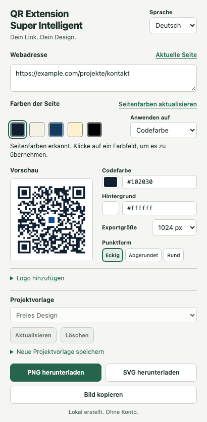

# QR Extension Super Intelligent

[English](README.en.md) · [Installation & Bedienung](ANLEITUNG.md) · [Datenschutz](DATENSCHUTZ.md)

QR-Codes für Webseiten und Unterseiten direkt im Browser gestalten. Kostenlos, ohne Nutzerkonto, lokal verarbeitet und unter MIT-Lizenz veröffentlicht.



## Funktionen

- Aktuelle Webadresse einschließlich Parametern und Sprungmarke übernehmen oder selbst eingeben.
- Bis zu vier häufige CSS-Farben der aktuellen Seite vorschlagen; Schwarz steht immer zur Auswahl.
- Codefarbe, Hintergrund, eckige/abgerundete/runde Punkte und Exportgröße einstellen.
- Auf Wunsch ein sichtbares Logo im Seitenkopf erkennen und lokal übernehmen; alternativ PNG, JPEG oder WebP hochladen.
- Logo vor dem Export ansehen und wieder entfernen.
- Farben, Form, Größe und Logo als benannte Projektvorlage lokal speichern; Vorlagen aktualisieren und löschen.
- PNG und SVG exportieren. Bei Logos prüfen eine hohe QR-Fehlerkorrektur und ein unabhängiger lokaler Decoder die Lesbarkeit vor dem Export.
- Den QR-Code auf Knopfdruck als PNG-Bild in die Zwischenablage kopieren und in unterstützten Apps einfügen.
- Deutsche und englische Oberfläche.

Die Farbvorschläge stammen aus der Seitengestaltung; sie sind keine exakte Analyse aller Bildpixel. Die Logoerkennung funktioniert nicht auf jeder Website. Der Produktname bezeichnet keine KI-Funktion: Es gibt keinen KI-Dienst und keine Cloud-Verarbeitung.

## Installieren

**Store-Veröffentlichungen für Firefox, Chrome und Edge stehen noch aus.** Es gibt derzeit keine Store-Installationslinks. Die Storekonten sind noch einzurichten.

- [GitHub-Releases](https://github.com/OgulcanKaya68/qr-extension-super-intelligent/releases): freigegebene Pakete und ihr jeweiliger Status.
- [Anleitung](ANLEITUNG.md): Firefox temporär laden, Chrome/Edge entpackt laden oder selbst bauen.
- Ein unsigniertes ZIP lässt sich in regulärem Firefox nicht dauerhaft installieren. Dafür ist Mozillas Signierung erforderlich.

Ein bestehender Build allein bestätigt keine vollständige Prüfung auf jedem Browser oder Betriebssystem. Ausgeführte Prüfungen und bekannte Grenzen stehen im [Prüfbericht](docs/PRUEFUNG.md).

## Datenschutz und Berechtigungen

- Kein Backend, keine QR-API, keine Telemetrie und keine Netzwerkanfragen durch die Produktfunktionen.
- Keine gespeicherte URL-Historie; Projektvorlagen enthalten keine Zieladressen.
- `activeTab`: aktuelle Seite nach einem bewussten Klick verwenden, einschließlich einer vorübergehenden sichtbaren Tabaufnahme für die optionale Logoübernahme.
- `scripting`: Seitengestaltung und sichtbare Logokandidaten erst auf Anforderung auslesen.
- `storage`: Gestaltung, Oberflächensprache und ausdrücklich gespeicherte Projektvorlagen im lokalen Browserprofil behalten.
- `clipboardWrite`: nach deinem Klick das QR-Bild in die Zwischenablage schreiben; kein Lesen und keine Überwachung der Zwischenablage.

Die komplette Tabaufnahme wird nicht gespeichert oder übertragen. Nur der gewählte Logoausschnitt kann Teil der letzten Gestaltung, einer gespeicherten Vorlage und eines Exports werden. In privaten Tabs werden keine Einstellungen oder Logos dauerhaft geschrieben. Details: [Datenschutz](DATENSCHUTZ.md).

## Entwickeln

Node.js mit npm verwenden; die unterstützte Version steht in `package.json` und der CI-Konfiguration.

```sh
npm ci
npm test
npm run build
npm run test:install
npm run test:browser
npm run lint:firefox
npm run package
```

`npm ci` und die Installation der Testbrowser benötigen Internet. Der Produktbetrieb benötigt keinen externen QR-Dienst. Builds entstehen in `build/firefox` und `build/chromium`, Pakete in `releases`.

## Grenzen und Mitmachen

- Unterstützt Webseiten mit `https://` oder `http://`; geschützte Browserseiten erlauben keine Seitenanalyse.
- Höchstens 100 Projektvorlagen. Gespeicherte Logos werden als PNG auf höchstens 64 KiB beziehungsweise 90.000 Base64-Zeichen begrenzt; Speicherfehler werden angezeigt.
- Logo-Uploads: PNG, JPEG oder WebP bis 4 MiB, höchstens 4096 Pixel pro Seite und 16 Millionen Pixel insgesamt. Lokal auf höchstens 256 Pixel normalisiert; keine SVG-Uploads. SVG-Exporte können das normalisierte PNG-Logo einbetten.
- Vorlagen bleiben im jeweiligen Browserprofil. Keine Synchronisierung oder Sicherung über einen eigenen Dienst.
- Ein Decodergebnis ist keine Garantie für jede Handykamera, Druckgröße oder Druckqualität. Export vor Veröffentlichung und Druck selbst scannen.
- Nur Logos verwenden, für die du die erforderlichen Rechte hast. Die MIT-Lizenz dieses Projekts erteilt keine Rechte an fremden Marken oder Logos.

[Fehler melden](https://github.com/OgulcanKaya68/qr-extension-super-intelligent/issues) · [Mitwirken](CONTRIBUTING.md) · [Sicherheitsmeldungen](SECURITY.md) · [Änderungen](CHANGELOG.md) · [Store-Vorbereitung](docs/STORES.md)

## Lizenz

[MIT](LICENSE), Copyright © 2026 OgulcanKaya68. Lokal mitgeliefert: `qrcode-generator` unter MIT und `jsQR` unter Apache-2.0 für die unabhängige Logo-Decodierprüfung. Lizenztexte und Hinweise: [DRITTANBIETER.txt](DRITTANBIETER.txt) und [jsQR-Lizenz](docs/licenses/jsqr-LICENSE.txt).
